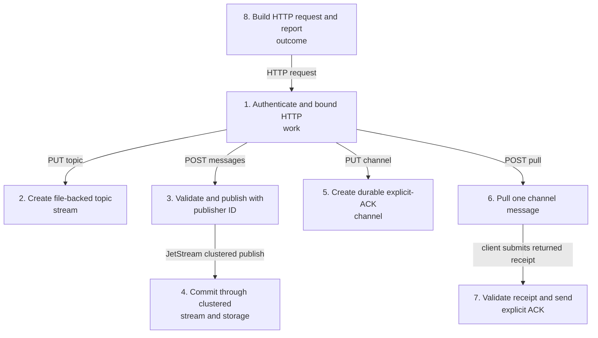
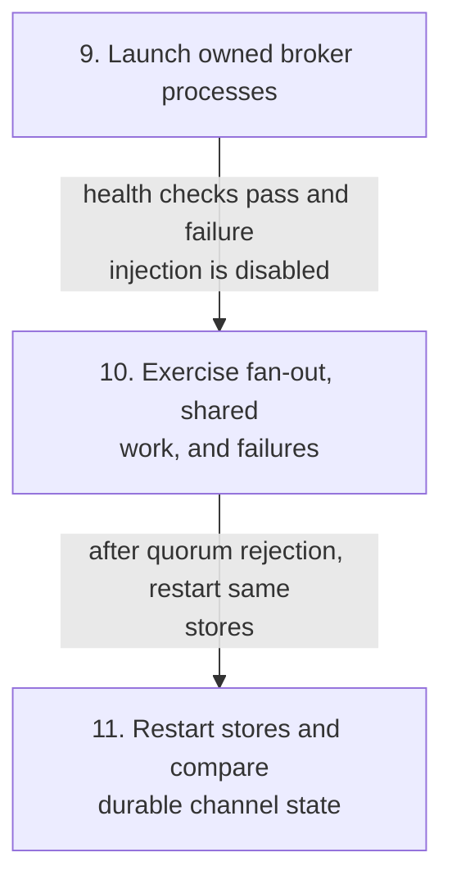
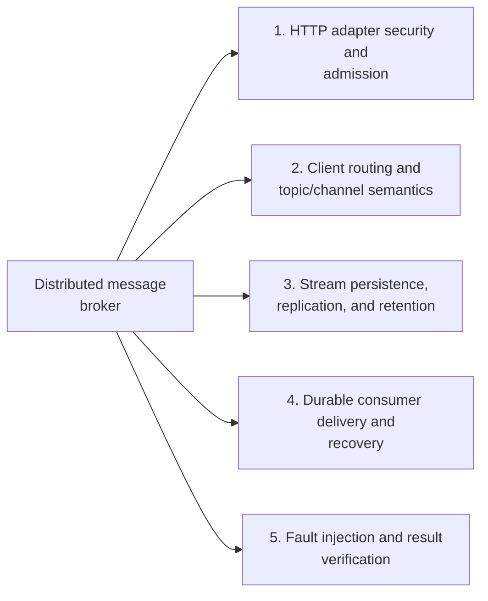
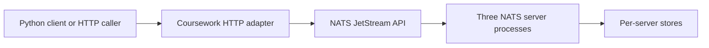
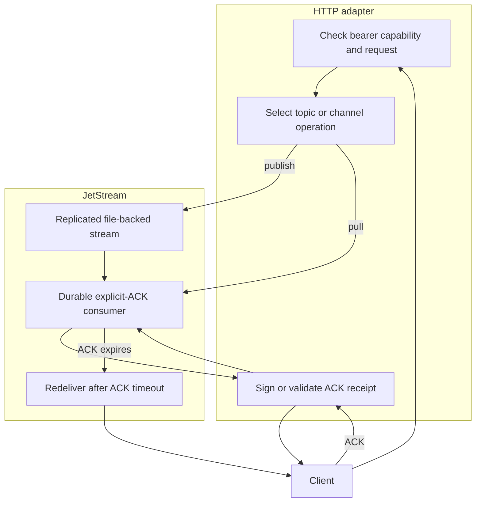

# Distributed message broker

## Contents

- [Architecture and execution guide](#architecture-and-execution-guide)
- [Build and verify](#build-and-verify)
- [Use the adapter](#use-the-adapter)
- [Delivery and resource limits](#delivery-and-resource-limits)
- [Implementation techniques](#implementation-techniques)

The [hosted broker measurement](coursework/BENCHMARK-RESULTS.md) completed 12,000/12,000 messages at 100 messages/s for 120 seconds, with scheduled-to-delivery+ACK p50/p95/p99 of 2.713 / 3.067 / 3.374 ms. At 1,024 bytes and four producers/consumers, five short 64-message batches had median throughput 423.863 messages/s (range 419.094–427.768). The 500/s sweep finished 2,874 of 5,000 offers and declined 2,126 at the generator; its negative verdict remains. Leader loss recovered all 64 messages, with first newly invoked post-kill ACK at 6.676 seconds and every transient error retained. Four visible Linux cores, Python 3.11.17 and Go 1.26.0; CPU model/RAM and native/adapter bottleneck profiles remain gaps. These are adapter/workload results, not maximum NATS capacity.

The [replicated benchmark driver](.agents/skills/verify-broker/features/benchmark.md) is reproducible with `python coursework/benchmark.py benchmark` on isolated Linux; `smoke` checks correctness and `profile` supplies separate diagnostics. Exact source, commands, five-repeat ranges, negative cells, resources and raw hashes are documented with the results. The 32 MiB retained-stream limit is unchanged.

A complete NATS JetStream broker with a course-facing HTTP topic/channel API, a Python standard-library client and a repeatable three-process failure/recovery oracle. Topics use three disk-backed replicas. Each durable channel receives the topic independently; workers sharing a channel divide its messages and explicitly acknowledge receipts.

This is a licensed adaptation of [NATS server v2.15.1](https://github.com/nats-io/nats-server/releases/tag/v2.15.1), pinned at `b2fd3efc7456b11b06a54877ad6f6ccfb911edb4`. The entire upstream history, implementation, tests, license and notices are retained. [README.upstream.md](README.upstream.md) is the unchanged upstream README. The upstream project owns the broker, Raft replication, storage, recovery and client protocol. The additions here are `coursework/`, its verification skill and documentation, covered by the repository's Apache-2.0 license.

The coursework connection is Stanford CS244b's [KiraraMQ report](https://www.scs.stanford.edu/24sp-cs244b/projects/KiraraMQ_A_Lightweight_Fault_Tolerant_and_Distributed_Message_Queue.pdf), by Zhemin Huang, Gavin Li, Ericka Liu and Yichun Qian. This adaptation studies its topics, channel fanout, shared consumers and retry semantics using an available licensed production broker. It does not reproduce the unavailable student source, KiraraMQ's etcd discovery or gRPC API. Durable replicated logs and explicit quorum-loss experiments are the extension, drawing on the durable-log design discussed in [Kafka's 2011 paper](https://notes.stephenholiday.com/Kafka.pdf). No university completion, original consensus algorithm or comparative performance claim is made.

## Architecture and execution guide

<!-- execution-flow:start -->
### Execution flow

Start with the primary path, then expand a detailed workflow. Select a numbered node to see its operation, implementation techniques, and source. Solid arrows show the named control, data, or lifecycle handoff; dotted arrows show error paths. Separate entry points are named in each workflow.

<a id="review-walkthrough"></a>

#### Walk through one concrete example

Publish the JSON message `event=ready` to an existing topic through the broker's HTTP adapter.

**Trace.** [Build HTTP request and report outcome](#flow-step-client-request) → [Authenticate and bound HTTP work](#flow-step-http-admission) → [Validate and publish with publisher ID](#flow-step-publish) → [Commit through clustered stream and storage](#flow-step-replicate-store).

**Result and boundary.** The adapter authenticates and bounds the request, validates the publish, then commits it through the clustered stream and storage path. Delivery to a durable explicit-ACK channel is a separate request path.

<details>
<summary>Implementation decisions to explain</summary>

**Why give the publish operation a publisher identity?** The broker validates publisher identity as part of admission and commits through its clustered stream/storage path, keeping accepted publish state tied to the configured publisher. The tradeoff is that callers must use the broker's configured identity and request contract.

[Windowed publisher-ID deduplication](#technique-windowed-publish-deduplication) · [Replicated streams and durable consumers](#technique-jetstream-replication).

</details>

#### Primary execution flow

Coursework requests enter ServeHTTP after the Python client builds a path. The graph shows admission and operation dispatch, with publish and pull/ACK as distinct branches; verification uses separate owned-process failure and restart checks.



**Detailed workflows.** [Adapter topic and channel requests](#flow-workflow-adapter-requests) · [Verification with owned processes](#flow-workflow-verification).

<a id="flow-workflow-adapter-requests"></a>

<details>
<summary>Adapter topic and channel requests</summary>

Independent HTTP operations select create, publish, channel creation, pull, or ACK branches after common admission.


</details>

<a id="flow-workflow-verification"></a>

<details>
<summary>Verification with owned processes</summary>

Independent coursework verification CLI launches processes, drives delivery and ACK checks, and tests restart. Product requests do not launch verification.



</details>

#### Steps, techniques, and source

These source traces cover the active scope below. They explain implementation behavior; benchmark results and their limits remain in the measurement sections.

<a id="flow-step-http-admission"></a>

##### 1. Authenticate and bound HTTP work

**Component.** coursework HTTP adapter. ServeHTTP compares the bearer capability in constant time, admits at most 32 concurrent requests, validates topic/channel path shape, and returns 401, 429, or 400 before dispatch. The server also sets finite header, read, write, idle, and header-size limits.

**Techniques at this step.** [Bounded HTTP request handling](#technique-bounded-http).

**Source.** [`coursework/cmd/topic-channel/main.go:98`](https://github.com/STEVVVU/distributed-message-broker/blob/main/coursework/cmd/topic-channel/main.go#L98) · [`coursework/cmd/topic-channel/main.go:185`](https://github.com/STEVVVU/distributed-message-broker/blob/main/coursework/cmd/topic-channel/main.go#L185). [Back to execution flow](#execution-flow).

<a id="flow-step-topic-create"></a>

##### 2. Create file-backed topic stream

**Component.** coursework HTTP adapter / JetStream. PUT /topics/{topic} adds stream B_{topic} for course.{topic}, with three replicas, file storage, limits retention, caps of 100000 messages and 32 MiB, DiscardNew, and a two-minute duplicate window.

**Techniques at this step.** [Topic fan-out and channel work sharing](#technique-topic-channel-fanout) · [Replicated streams and durable consumers](#technique-jetstream-replication) · [Bounded retention and delivery backpressure](#technique-bounded-retention-backpressure) · [Windowed publisher-ID deduplication](#technique-windowed-publish-deduplication).

**Source.** [`coursework/cmd/topic-channel/main.go:98`](https://github.com/STEVVVU/distributed-message-broker/blob/main/coursework/cmd/topic-channel/main.go#L98). [Back to execution flow](#execution-flow).

<a id="flow-step-publish"></a>

##### 3. Validate and publish with publisher ID

**Component.** coursework HTTP adapter / JetStream stream. POST messages accepts one bounded JSON object, validates nonempty data up to 32768 bytes and a safe publisher ID, then calls Publish on course.{topic} with MsgId. The response carries stream sequence and duplicate status; broker errors become HTTP 503.

**Techniques at this step.** [Windowed publisher-ID deduplication](#technique-windowed-publish-deduplication) · [Separate acknowledged and uncertain outcomes](#technique-uncertain-outcome-accounting).

**Source.** [`coursework/cmd/topic-channel/main.go:85`](https://github.com/STEVVVU/distributed-message-broker/blob/main/coursework/cmd/topic-channel/main.go#L85) · [`coursework/cmd/topic-channel/main.go:98`](https://github.com/STEVVVU/distributed-message-broker/blob/main/coursework/cmd/topic-channel/main.go#L98) · [`server/stream.go:5619`](https://github.com/STEVVVU/distributed-message-broker/blob/main/server/stream.go#L5619) · [`server/stream.go:5628`](https://github.com/STEVVVU/distributed-message-broker/blob/main/server/stream.go#L5628). [Back to execution flow](#execution-flow).

<a id="flow-step-replicate-store"></a>

##### 4. Commit through clustered stream and storage

**Component.** JetStream stream, Raft, and file store. The clustered inbound path proposes the message to the stream Raft group. Replication and quorum govern acceptance; the file store enforces configured size and retention limits and stores accepted records. This describes inherited broker mechanisms called by the adapter, not coursework consensus code.

**Techniques at this step.** [Replicated streams and durable consumers](#technique-jetstream-replication) · [Bounded retention and delivery backpressure](#technique-bounded-retention-backpressure).

**Source.** [`server/jetstream_cluster.go:13076`](https://github.com/STEVVVU/distributed-message-broker/blob/main/server/jetstream_cluster.go#L13076) · [`server/filestore.go:5630`](https://github.com/STEVVVU/distributed-message-broker/blob/main/server/filestore.go#L5630) · [`server/raft.go:1376`](https://github.com/STEVVVU/distributed-message-broker/blob/main/server/raft.go#L1376). [Back to execution flow](#execution-flow).

<a id="flow-step-channel-create"></a>

##### 5. Create durable explicit-ACK channel

**Component.** coursework HTTP adapter / JetStream consumer. PUT channels adds a durable consumer with explicit ACK, all-message delivery, two-second AckWait, maximum 128 pending ACKs, 32 waiting pulls, batch maximum 16, one-second request expiry, and three replicas.

**Techniques at this step.** [Pull work sharing with explicit ACK](#technique-pull-ack) · [Replicated streams and durable consumers](#technique-jetstream-replication) · [Topic fan-out and channel work sharing](#technique-topic-channel-fanout).

**Source.** [`coursework/cmd/topic-channel/main.go:98`](https://github.com/STEVVVU/distributed-message-broker/blob/main/coursework/cmd/topic-channel/main.go#L98). [Back to execution flow](#execution-flow).

<a id="flow-step-pull-deliver"></a>

##### 6. Pull one channel message

**Component.** coursework HTTP adapter / JetStream consumer. POST pull binds a pull subscription to the named stream and durable, fetches one message with a 750 ms maximum wait, and returns an empty list on timeout. A delivery includes payload, stream sequence, delivery attempt, and a signed receipt; the subscription is then unsubscribed.

**Techniques at this step.** [Pull work sharing with explicit ACK](#technique-pull-ack) · [Topic fan-out and channel work sharing](#technique-topic-channel-fanout).

**Source.** [`coursework/cmd/topic-channel/main.go:98`](https://github.com/STEVVVU/distributed-message-broker/blob/main/coursework/cmd/topic-channel/main.go#L98) · [`server/consumer.go:3441`](https://github.com/STEVVVU/distributed-message-broker/blob/main/server/consumer.go#L3441). [Back to execution flow](#execution-flow).

<a id="flow-step-receipt-ack"></a>

##### 7. Validate receipt and send explicit ACK

**Component.** coursework HTTP adapter / JetStream consumer. The adapter signs receipt fields with HMAC-SHA256. On ACK it checks token size and shape, signature, cluster, topic, channel, expiry, and generated ACK subject prefix, then sends +ACK with a two-second NATS request timeout. Invalid receipts return 400; broker errors return 503.

**Techniques at this step.** [HMAC-bound ACK receipts](#technique-ack-receipt-hmac) · [Pull work sharing with explicit ACK](#technique-pull-ack).

**Source.** [`coursework/cmd/topic-channel/main.go:43`](https://github.com/STEVVVU/distributed-message-broker/blob/main/coursework/cmd/topic-channel/main.go#L43) · [`coursework/cmd/topic-channel/main.go:51`](https://github.com/STEVVVU/distributed-message-broker/blob/main/coursework/cmd/topic-channel/main.go#L51) · [`coursework/cmd/topic-channel/main.go:98`](https://github.com/STEVVVU/distributed-message-broker/blob/main/coursework/cmd/topic-channel/main.go#L98) · [`server/consumer.go:3733`](https://github.com/STEVVVU/distributed-message-broker/blob/main/server/consumer.go#L3733). [Back to execution flow](#execution-flow).

<a id="flow-step-client-request"></a>

##### 8. Build HTTP request and report outcome

**Component.** Python Broker client. Broker constructs topic/channel paths with URL quoting and sends JSON with the bearer capability under a six-second urllib timeout. HTTP errors are observed then raised; successful responses are observed and returned without retrying.

**Techniques at this step.** [Separate acknowledged and uncertain outcomes](#technique-uncertain-outcome-accounting) · [Topic fan-out and channel work sharing](#technique-topic-channel-fanout).

**Source.** [`coursework/client.py:14`](https://github.com/STEVVVU/distributed-message-broker/blob/main/coursework/client.py#L14). [Back to execution flow](#execution-flow).

<a id="flow-step-verify-launch"></a>

##### 9. Launch owned broker processes

**Component.** coursework verification driver. Cluster creates three loopback node configurations with separate stores, starts recorded child processes, and polls health. The finally block terminates only recorded processes and writes result evidence while preserving event logs.

**Techniques at this step.** [Owned-process fault injection and recovery oracles](#technique-owned-process-recovery-oracle).

**Source.** [`coursework/verify.py:38`](https://github.com/STEVVVU/distributed-message-broker/blob/main/coursework/verify.py#L38) · [`coursework/verify.py:96`](https://github.com/STEVVVU/distributed-message-broker/blob/main/coursework/verify.py#L96). [Back to execution flow](#execution-flow).

<a id="flow-step-verify-journey"></a>

##### 10. Exercise fan-out, shared work, and failures

**Component.** coursework verification journey. The journey creates a topic and two channels, publishes and checks duplicate-ID behavior, abandons a delivered billing message and observes redelivery, rejects cross-channel receipt use, and checks that two workers share distinct billing messages. It then kills the leader, accepts a quorum write, removes a second node, and requires a bounded 503 for a no-quorum publish.

**Techniques at this step.** [Owned-process fault injection and recovery oracles](#technique-owned-process-recovery-oracle) · [Separate acknowledged and uncertain outcomes](#technique-uncertain-outcome-accounting) · [Topic fan-out and channel work sharing](#technique-topic-channel-fanout) · [Windowed publisher-ID deduplication](#technique-windowed-publish-deduplication).

**Source.** [`coursework/verify.py:145`](https://github.com/STEVVVU/distributed-message-broker/blob/main/coursework/verify.py#L145). [Back to execution flow](#execution-flow).

<a id="flow-step-verify-restart-oracle"></a>

##### 11. Restart stores and compare durable channel state

**Component.** coursework verification journey. After restarting failed nodes and then the full cluster on the same stores, the driver drains both channels and compares accepted payloads and sequences with its ledger. It excludes the no-quorum request from acknowledged writes because the timed-out or failed request may have committed; this is a verification oracle, not production recovery handling.

**Techniques at this step.** [Owned-process fault injection and recovery oracles](#technique-owned-process-recovery-oracle) · [Separate acknowledged and uncertain outcomes](#technique-uncertain-outcome-accounting) · [Pull work sharing with explicit ACK](#technique-pull-ack) · [Replicated streams and durable consumers](#technique-jetstream-replication).

**Source.** [`coursework/verify.py:207`](https://github.com/STEVVVU/distributed-message-broker/blob/main/coursework/verify.py#L207) · [`coursework/verify.py:64`](https://github.com/STEVVVU/distributed-message-broker/blob/main/coursework/verify.py#L64) · [`coursework/verify.py:72`](https://github.com/STEVVVU/distributed-message-broker/blob/main/coursework/verify.py#L72). [Back to execution flow](#execution-flow).

<details>
<summary>Scope and subsystem coverage</summary>

Coursework HTTP adapter and Python client, plus directly invoked inherited JetStream stream, storage, replication, and durable consumer paths and the owned-process verification journey.

- **HTTP adapter security and admission.** Common bearer, concurrency, path and body limits and per-operation adapter handling. [Step 1](#flow-step-http-admission), [Step 2](#flow-step-topic-create), [Step 3](#flow-step-publish), [Step 5](#flow-step-channel-create), [Step 6](#flow-step-pull-deliver), [Step 7](#flow-step-receipt-ack).
- **Client routing and topic/channel semantics.** Topic subject routing and per-topic durable channels, including fan-out and shared workers in the verification journey. [Step 8](#flow-step-client-request), [Step 2](#flow-step-topic-create), [Step 3](#flow-step-publish), [Step 6](#flow-step-pull-deliver), [Step 10](#flow-step-verify-journey).
- **Stream persistence, replication, and retention.** Configured limits and dedup window feed inherited clustered stream, Raft, file-store, and restart persistence paths. [Step 2](#flow-step-topic-create), [Step 3](#flow-step-publish), [Step 4](#flow-step-replicate-store), [Step 11](#flow-step-verify-restart-oracle).
- **Durable consumer delivery and recovery.** Durable explicit ACK configuration, one-at-a-time pull, receipt validation, timeout redelivery and persisted channel state are exercised. [Step 5](#flow-step-channel-create), [Step 6](#flow-step-pull-deliver), [Step 7](#flow-step-receipt-ack), [Step 10](#flow-step-verify-journey), [Step 11](#flow-step-verify-restart-oracle).
- **Fault injection and result verification.** The driver owns process lifecycle and records accepted, rejected, and uncertain outcomes separately. [Step 9](#flow-step-verify-launch), [Step 10](#flow-step-verify-journey), [Step 11](#flow-step-verify-restart-oracle), [Step 8](#flow-step-client-request).

Outside this flow audit:

- `.github/upstream-workflows`. Inactive upstream release automation; coursework verification does not invoke it.

</details>

<!-- execution-flow:end -->

<details>
<summary>Subsystem technique index</summary>

### Subsystem map

Select a subsystem in the diagram to open its techniques, tradeoffs, and code references. The numbered links provide the same navigation. This map groups components; the execution diagrams show their runtime flow.



1. [HTTP adapter security and admission](#subsystem-http-adapter-security-and-admission)
2. [Client routing and topic/channel semantics](#subsystem-client-routing-and-topicchannel-semantics)
3. [Stream persistence, replication, and retention](#subsystem-stream-persistence-replication-and-retention)
4. [Durable consumer delivery and recovery](#subsystem-durable-consumer-delivery-and-recovery)
5. [Fault injection and result verification](#subsystem-fault-injection-and-result-verification)

This repository contains the complete upstream NATS server and its JetStream implementation. The added scope is a Go HTTP adapter, a Python client, and local verification. NATS owns persistence, replication, leader election, stream sequences, and consumer state. The adapter translates a small topic/channel API into JetStream operations.

This boundary map shows how requests reach the inherited broker and its replicated storage.

</details>

<details>
<summary>Expand flow diagram 1</summary>



</details>

The adapter authenticates and validates HTTP requests, then calls JetStream. JetStream replicates stream and durable consumer state across the configured NATS cluster. The Python client adds request construction and optional observation; it does not change delivery guarantees.

The request flow below shows the publish and consume paths, including retry eligibility after a missed ACK.

<details>
<summary>Expand flow diagram 2</summary>



</details>

An ACK receipt binds the topic, channel, broker address list, expiry, and JetStream ACK subject. The adapter verifies its HMAC before issuing the ACK request. A lost response can leave the publish outcome uncertain; the caller must use the same publisher ID only for the same logical payload.

| Subsystem | Responsibility | Owned state or invariant | Source |
| --- | --- | --- | --- |
| HTTP adapter | Authentication, request limits, routing, receipt checks | 32 in-flight slots; 64 KiB JSON cap; loopback-only binding | [`coursework/cmd/topic-channel/main.go`](coursework/cmd/topic-channel/main.go) |
| Python client | Build API calls and expose broker results | Uses one bearer capability; leaves retry policy to caller | [`coursework/client.py`](coursework/client.py) |
| JetStream stream | Retain and replicate topic messages | Three replicas, bounded message and byte counts, two-minute duplicate window | [`server/jetstream.go`](server/jetstream.go) |
| Durable consumer | Fan out channels and divide channel work | Explicit ACK, 2-second ACK wait, 128 pending ACKs | [`server/jetstream.go`](server/jetstream.go) |
| Verification driver | Start owned nodes and check message/recovery outcomes | Tracks acknowledged versus uncertain publishes and owned PIDs | [`coursework/verify.py`](coursework/verify.py) |

Terms used in the request path: [JetStream](#concept-jetstream), [streams](#concept-stream), [durable consumers](#concept-durable-consumer), [explicit ACKs](#concept-explicit-ack), [redelivery](#concept-redelivery), [publisher deduplication](#concept-publisher-deduplication), [ACK receipts](#concept-ack-receipt), and [quorum](#concept-quorum).

### Follow one message

1. Start three NATS processes with distinct stores and shared cluster settings, then start the adapter with the same server list and `BROKER_TOKEN`.
2. The client creates a topic. The adapter creates a three-replica JetStream stream with bounded retention.
3. The client creates a channel. JetStream creates an independent durable consumer that starts at the first retained message.
4. The client publishes data and a publisher ID. JetStream returns a stream sequence or reports a duplicate inside its bounded deduplication window.
5. A client pulls one message. The adapter returns its sequence, delivery attempt, and signed ACK receipt.
6. The client ACKs the receipt. If it does not, JetStream can redeliver after the ACK timeout. If the broker is unavailable, HTTP returns an error; retrying a timed-out publish may still encounter an already-committed message.

### Design decisions and limits

These rationales are inferred from the current implementation. They do not record historic design intent.

| Choice | Practical rationale | Alternative and cost | Reconsider when |
| --- | --- | --- | --- |
| Adapt JetStream instead of adding consensus or storage | Inherited NATS already owns replication and durable consumers | A custom broker could tailor semantics but would duplicate consensus, persistence, and recovery work | The required semantics cannot be expressed by JetStream |
| Use pull consumers with explicit ACK | Workers can share a durable channel and control when work is complete | Push delivery reduces polling but gives the adapter less control over demand | A real deployment needs push delivery or higher pull efficiency |
| Sign short-lived receipts containing ACK subjects | HTTP callers can ACK without receiving arbitrary NATS credentials | Server-side receipt storage avoids exposing tokens but adds state and cleanup | Multi-tenant isolation or revocation requirements change |
| Keep one bounded stream per topic | Limits retention and gives each topic native sequence numbering | Shared streams reduce stream count but complicate per-topic limits and isolation | Topic counts or retention policy exceed the fixed bounds |

### Glossary

<a id="concept-jetstream"></a>

<details><summary>What is JetStream?</summary>

JetStream is NATS's persistence and streaming subsystem. Here it stores replicated topic messages and durable consumer progress. For example, a stream is named `B_orders` for the `orders` topic.
</details>

<a id="concept-stream"></a>

<details><summary>What is a stream?</summary>

A stream is an ordered, retained sequence of messages for configured subjects. The adapter creates one per topic, with a 100,000-message and 32 MiB cap.
</details>

<a id="concept-durable-consumer"></a>

<details><summary>What is a durable consumer?</summary>

A durable consumer keeps delivery and ACK state across reconnects. Each channel maps to one consumer, so separate channels each receive the topic independently.
</details>

<a id="concept-explicit-ack"></a>

<details><summary>What is an explicit ACK?</summary>

An explicit ACK tells the broker that a delivered message is complete. The channel consumer uses it so an unacknowledged message can be retried after two seconds.
</details>

<a id="concept-redelivery"></a>

<details><summary>What is redelivery?</summary>

Redelivery is another delivery attempt after the broker has not received an ACK in time. The API reports the attempt count; processing can therefore happen more than once.
</details>

<a id="concept-publisher-deduplication"></a>

<details><summary>What is publisher deduplication?</summary>

The stream temporarily recognizes repeated publisher IDs. This adapter configures a two-minute window, so the ID does not prevent later duplicates outside that period.
</details>

<a id="concept-ack-receipt"></a>

<details><summary>What is an ACK receipt?</summary>

An ACK receipt is an HMAC-signed token that authorizes one JetStream ACK subject for a topic and channel. It expires after ten minutes and is bound to the configured server-address list.
</details>

<a id="concept-quorum"></a>

<details><summary>What is a quorum?</summary>

A quorum is the majority of configured replicas needed for replicated progress. The three-server recovery journey checks writes after leader loss, then checks bounded rejection after another replica is removed.
</details>

## Implementation techniques

This section covers the active coursework adapter and the JetStream mechanisms it directly invokes. Rationale is inferred from current code.

<details>
<summary>Full technique index</summary>

| Subsystem | Techniques | Code |
| --- | --- | --- |
| HTTP adapter security and admission | [HMAC-bound ACK receipts](#technique-ack-receipt-hmac), [Bounded HTTP request handling](#technique-bounded-http), [Bounded retention and delivery backpressure](#technique-bounded-retention-backpressure) | [coursework/cmd/topic-channel/main.go](coursework/cmd/topic-channel/main.go) |
| Client routing and topic/channel semantics | [Topic fan-out and channel work sharing](#technique-topic-channel-fanout), [Separate acknowledged and uncertain outcomes](#technique-uncertain-outcome-accounting) | [coursework/cmd/topic-channel/main.go](coursework/cmd/topic-channel/main.go), [coursework/client.py](coursework/client.py) |
| Stream persistence, replication, and retention | [Replicated streams and durable consumers](#technique-jetstream-replication), [Windowed publisher-ID deduplication](#technique-windowed-publish-deduplication), [Bounded retention and delivery backpressure](#technique-bounded-retention-backpressure) | [coursework/cmd/topic-channel/main.go](coursework/cmd/topic-channel/main.go), [server/jetstream.go](server/jetstream.go), [server/stream.go](server/stream.go), [server/jetstream_cluster.go](server/jetstream_cluster.go), [server/filestore.go](server/filestore.go), [server/raft.go](server/raft.go) |
| Durable consumer delivery and recovery | [Pull work sharing with explicit ACK](#technique-pull-ack), [Topic fan-out and channel work sharing](#technique-topic-channel-fanout) | [coursework/cmd/topic-channel/main.go](coursework/cmd/topic-channel/main.go), [server/consumer.go](server/consumer.go) |
| Fault injection and result verification | [Owned-process fault injection and recovery oracles](#technique-owned-process-recovery-oracle), [Separate acknowledged and uncertain outcomes](#technique-uncertain-outcome-accounting) | [coursework/verify.py](coursework/verify.py), [coursework/client.py](coursework/client.py) |

</details>

<a id="subsystem-http-adapter-security-and-admission"></a>

### 1. HTTP adapter security and admission

[Back to the subsystem map](#architecture-and-execution-guide).

**Code.** [`coursework/cmd/topic-channel/main.go`](coursework/cmd/topic-channel/main.go).

**Techniques.** [HMAC-bound ACK receipts](#technique-ack-receipt-hmac), [Bounded HTTP request handling](#technique-bounded-http), [Bounded retention and delivery backpressure](#technique-bounded-retention-backpressure).

**Related concepts.** [JetStream](#concept-jetstream), [stream](#concept-stream), [redelivery](#concept-redelivery), [ACK receipt](#concept-ack-receipt).

<a id="technique-ack-receipt-hmac"></a>

<details>
<summary>HMAC-bound ACK receipts</summary>

**Mechanism.** The adapter serializes the ACK subject with topic, channel, configured-cluster digest, and expiry, then signs the payload with HMAC-SHA256. On ACK, it decodes the token, compares signatures with `hmac.Equal`, checks bindings and expiry, and limits the subject to the expected JetStream ACK prefix.

**Example.** A receipt for `orders/billing` can authorize its generated ACK subject, but cannot be reused for another channel.

**Why here.** HTTP callers need to acknowledge deliveries without receiving NATS credentials.

**Tradeoffs.** A changed key or server list invalidates receipts. Signing does not make processing exactly once, and native ACK semantics still apply after redelivery.

**Code and ownership.** [`sign`](coursework/cmd/topic-channel/main.go#L43) and [`decode`](coursework/cmd/topic-channel/main.go#L51), extension.


**Used in.** [HTTP adapter security and admission](#subsystem-http-adapter-security-and-admission). [Back to the subsystem map](#architecture-and-execution-guide).

</details>

<a id="technique-bounded-http"></a>

<details>
<summary>Bounded HTTP request handling</summary>

**Mechanism.** The handler limits JSON body size and concurrent broker operations, while the HTTP server applies read, write, idle, and header limits. Requests are validated before dispatch to JetStream.

**Example.** `busy` is a buffered channel with 32 slots; a request that cannot acquire a slot receives a bounded failure instead of starting unbounded broker work.

**Why here.** The adapter is a small single-tenant boundary and needs fixed resource ceilings.

**Tradeoffs.** Excess requests fail under load, and these limits do not constrain direct native NATS administration.

**Code and ownership.** [`ServeHTTP`](coursework/cmd/topic-channel/main.go#L98) and server setup in [`main`](coursework/cmd/topic-channel/main.go#L185), extension.


**Used in.** [HTTP adapter security and admission](#subsystem-http-adapter-security-and-admission). [Back to the subsystem map](#architecture-and-execution-guide).

</details>

<a id="technique-bounded-retention-backpressure"></a>

<details>
<summary>Bounded retention and delivery backpressure</summary>

**Mechanism.** Stream creation sets message, byte, message-size, and consumer-count limits with `DiscardNew`. Channel creation caps pending ACKs, waiting pulls, request batch size, and request duration. Separate adapter admission uses 32 nonblocking slots; it rejects excess concurrent requests rather than queue them without bound.

**Example.** A topic is configured for 100,000 messages and 32 MiB. Reaching a stream limit rejects a new publish; acknowledging a delivery advances consumer state but does not remove messages under this limits-based retention policy.

**Why here.** Explicit limits bound retained broker resources and outstanding delivery work independently of HTTP request admission.

**Tradeoffs.** Fixed caps can reject legitimate bursts. There is no time-based stream expiry or capacity autoscaling here. HTTP 429 reports adapter saturation; broker failures become 503 and do not establish whether a timed-out write committed.

**Code and ownership.** [`stream and consumer configuration`](coursework/cmd/topic-channel/main.go#L124), inherited [`clustered ingestion limits`](server/jetstream_cluster.go#L13076), mixed.


**Used in.** [HTTP adapter security and admission](#subsystem-http-adapter-security-and-admission), [Stream persistence, replication, and retention](#subsystem-stream-persistence-replication-and-retention). [Back to the subsystem map](#architecture-and-execution-guide).

</details>

<a id="subsystem-client-routing-and-topicchannel-semantics"></a>

### 2. Client routing and topic/channel semantics

[Back to the subsystem map](#architecture-and-execution-guide).

**Code.** [`coursework/cmd/topic-channel/main.go`](coursework/cmd/topic-channel/main.go), [`coursework/client.py`](coursework/client.py).

**Techniques.** [Topic fan-out and channel work sharing](#technique-topic-channel-fanout), [Separate acknowledged and uncertain outcomes](#technique-uncertain-outcome-accounting).

**Related concepts.** [JetStream](#concept-jetstream), [stream](#concept-stream), [durable consumer](#concept-durable-consumer), [quorum](#concept-quorum).

<a id="technique-topic-channel-fanout"></a>

<details>
<summary>Topic fan-out and channel work sharing</summary>

**Mechanism.** A safe topic name maps to stream `B_<topic>` and subject `course.<topic>`. Each channel maps to an independent durable consumer starting at the first retained message. Pullers bound to the same consumer divide that channel’s deliveries; another channel maintains its own progress.

**Example.** The verification journey creates `billing` and `shipping` for `orders`. Both channels see the topic, while two billing clients pull distinct messages from the shared billing consumer.

**Why here.** Native stream and consumer namespaces express both fan-out between services and work sharing within one service.

**Tradeoffs.** Each topic and channel consumes broker metadata and replication resources. Deliveries can be repeated and processing can finish out of order. These namespaces share one adapter capability rather than provide separate tenant authorization.

**Code and ownership.** [`ServeHTTP`](coursework/cmd/topic-channel/main.go#L98) and [`Broker`](coursework/client.py#L8), extension routing over inherited JetStream consumers.


**Used in.** [Client routing and topic/channel semantics](#subsystem-client-routing-and-topicchannel-semantics), [Durable consumer delivery and recovery](#subsystem-durable-consumer-delivery-and-recovery). [Back to the subsystem map](#architecture-and-execution-guide).

</details>

<a id="technique-uncertain-outcome-accounting"></a>

<details>
<summary>Separate acknowledged and uncertain outcomes</summary>

**Mechanism.** The client exposes HTTP results and errors without automatically retrying arbitrary operations. The recovery journey records acknowledged publishes by sequence, retries one logical ID through leader loss, and keeps a no-quorum timeout separate as an uncertain outcome. After restart it compares recovered accepted messages while allowing that one explicitly uncertain publish to be present or absent.

**Example.** `uncertain-no-quorum` must return a bounded error; the later oracle does not incorrectly interpret that error as proof the record can never appear.

**Why here.** An interrupted request and a rejected state transition are different observations in a replicated system.

**Tradeoffs.** The test cannot resolve every timed-out operation. Its accepted-message ledger and sequence checks are scoped evidence, not a complete linearizability proof or a power-loss durability test.

**Code and ownership.** [`Broker.request`](coursework/client.py#L14) and [`journey`](coursework/verify.py#L145), extension verification and client policy.


**Used in.** [Client routing and topic/channel semantics](#subsystem-client-routing-and-topicchannel-semantics), [Fault injection and result verification](#subsystem-fault-injection-and-result-verification). [Back to the subsystem map](#architecture-and-execution-guide).

</details>

<a id="subsystem-stream-persistence-replication-and-retention"></a>

### 3. Stream persistence, replication, and retention

[Back to the subsystem map](#architecture-and-execution-guide).

**Code.** [`coursework/cmd/topic-channel/main.go`](coursework/cmd/topic-channel/main.go), [`server/jetstream.go`](server/jetstream.go), [`server/stream.go`](server/stream.go), [`server/jetstream_cluster.go`](server/jetstream_cluster.go), [`server/filestore.go`](server/filestore.go), [`server/raft.go`](server/raft.go).

**Techniques.** [Replicated streams and durable consumers](#technique-jetstream-replication), [Windowed publisher-ID deduplication](#technique-windowed-publish-deduplication).

**Related concepts.** [JetStream](#concept-jetstream), [stream](#concept-stream), [durable consumer](#concept-durable-consumer), [quorum](#concept-quorum).

**Shared techniques.** [Bounded retention and delivery backpressure](#technique-bounded-retention-backpressure).

<a id="technique-jetstream-replication"></a>

<details>
<summary>Replicated streams and durable consumers</summary>

**Mechanism.** The adapter creates bounded JetStream streams with three replicas and durable consumers. JetStream owns replicated log state, sequence assignment, leader recovery, and consumer ACK state; the adapter calls those APIs rather than implementing consensus or storage.

**Example.** A topic publish becomes an append to its stream; a channel's durable consumer tracks delivery and acknowledgement independently.

**Why here.** The extension focuses on topic/channel API semantics while reusing NATS's maintained broker implementation.

**Tradeoffs.** Behavior and guarantees follow the pinned NATS version. The local recovery check does not prove power-loss durability or cross-host availability.

**Code and ownership.** Inherited [`clustered stream ingestion`](server/jetstream_cluster.go#L13076), [`file store`](server/filestore.go#L5630), and [`Raft quorum calculation`](server/raft.go#L1376); creation settings in adapter [`ServeHTTP`](coursework/cmd/topic-channel/main.go#L98), extension.


**Used in.** [Stream persistence, replication, and retention](#subsystem-stream-persistence-replication-and-retention). [Back to the subsystem map](#architecture-and-execution-guide).

</details>

<a id="technique-windowed-publish-deduplication"></a>

<details>
<summary>Windowed publisher-ID deduplication</summary>

**Mechanism.** Publish requests require a safe publisher ID and pass it as the NATS message ID. JetStream checks its retained ID map and returns the prior sequence for a duplicate. Timer-driven expiry removes IDs older than the configured two-minute window; new IDs are recorded for later lookup.

**Example.** The journey publishes `first` twice with publisher ID `first` and requires the second receipt to identify the original sequence as a duplicate.

**Why here.** A caller can retry an uncertain publish using the same logical identity without immediately appending it again.

**Tradeoffs.** IDs are scoped to a stream and remembered for a finite window. Reusing an ID for different data can suppress that data; waiting beyond the window can append a duplicate. This does not make external processing exactly once.

**Code and ownership.** Adapter [`publish dispatch`](coursework/cmd/topic-channel/main.go#L137), inherited [`checkMsgId` and `purgeMsgIds`](server/stream.go#L5619), mixed.


**Used in.** [Stream persistence, replication, and retention](#subsystem-stream-persistence-replication-and-retention). [Back to the subsystem map](#architecture-and-execution-guide).

</details>

<a id="subsystem-durable-consumer-delivery-and-recovery"></a>

### 4. Durable consumer delivery and recovery

[Back to the subsystem map](#architecture-and-execution-guide).

**Code.** [`coursework/cmd/topic-channel/main.go`](coursework/cmd/topic-channel/main.go), [`server/consumer.go`](server/consumer.go).

**Techniques.** [Pull work sharing with explicit ACK](#technique-pull-ack).

**Related concepts.** [JetStream](#concept-jetstream), [stream](#concept-stream), [explicit ACK](#concept-explicit-ack).

**Shared techniques.** [Topic fan-out and channel work sharing](#technique-topic-channel-fanout).

<a id="technique-pull-ack"></a>

<details>
<summary>Pull work sharing with explicit ACK</summary>

**Mechanism.** Each channel maps to a durable JetStream consumer. Workers pull from that shared consumer, so the broker assigns outstanding messages among them; each worker ACKs only after processing. Separate channels have separate consumer state and independently see the topic.

**Example.** Two workers pulling `orders/billing` divide that consumer's pending work, while `orders/audit` receives its own stream deliveries.

**Why here.** Pulling lets workers control demand, and explicit ACK allows retry after an unacknowledged delivery.

**Tradeoffs.** Retries can repeat work and completion order can differ from stream order. The implementation has bounded pending ACKs and an ACK timeout.

**Code and ownership.** Adapter dispatch in [`ServeHTTP`](coursework/cmd/topic-channel/main.go#L98); pull consumers and ACK state in inherited [`processAckMsgLocked`](server/consumer.go#L3733) and [`applyState`](server/consumer.go#L3441), mixed extension/inherited implementation.


**Used in.** [Durable consumer delivery and recovery](#subsystem-durable-consumer-delivery-and-recovery). [Back to the subsystem map](#architecture-and-execution-guide).

</details>

<a id="subsystem-fault-injection-and-result-verification"></a>

### 5. Fault injection and result verification

[Back to the subsystem map](#architecture-and-execution-guide).

**Code.** [`coursework/verify.py`](coursework/verify.py), [`coursework/client.py`](coursework/client.py).

**Techniques.** [Owned-process fault injection and recovery oracles](#technique-owned-process-recovery-oracle).

**Related concepts.** [quorum](#concept-quorum).

**Shared techniques.** [Separate acknowledged and uncertain outcomes](#technique-uncertain-outcome-accounting).

<a id="technique-owned-process-recovery-oracle"></a>

<details>
<summary>Owned-process fault injection and recovery oracles</summary>

**Mechanism.** The driver launches three broker processes with distinct local stores, records handles and events, and checks replica health before injecting leader loss and quorum loss. It restarts the same stores and compares message bytes and sequences against the accepted ledger for each channel. A finally block terminates only recorded child processes and retains logs and result files.

**Example.** An abandoned consumer process leaves its first delivery unacknowledged; the journey requires a later delivery attempt, then verifies a receipt cannot be acknowledged through a different channel.

**Why here.** Real broker processes exercise storage, delivery state, request boundaries, and recovery together.

**Tradeoffs.** Processes share one host and filesystem. Killing them does not simulate independent machines, arbitrary partitions, disk corruption, or power failure. Polling deadlines are test bounds rather than production availability guarantees.

**Code and ownership.** [`Cluster`](coursework/verify.py#L38), [`run`](coursework/verify.py#L96), and [`journey`](coursework/verify.py#L145), extension.


**Used in.** [Fault injection and result verification](#subsystem-fault-injection-and-result-verification). [Back to the subsystem map](#architecture-and-execution-guide).

</details>

## Build and verify

Requires Go matching `go.mod` (validated locally with Go 1.27.3), Python 3.11+, no containers, credentials or paid services. The existing `nats.go v1.53.1` dependency is reused without changing module dependencies.

```powershell
go build -o .local/nats-server.exe .
go build -o .local/topic-channel.exe ./coursework/cmd/topic-channel
go test ./coursework/...
go vet ./coursework/...
go test ./server -run '^TestJetStreamConfig(ExplicitZeroLimits|NegativeLimitsFallBackToDynamic)$' -count=1
python coursework/verify.py
```

The `.exe` output names also work as executable filenames on Linux. The driver starts three separate loopback processes with owned stores, random ports and random authentication. It exercises HTTP/Python, exits an unacknowledged consumer process, checks redelivery attempts and duplicate publisher IDs, shares a channel between workers, kills the actual stream leader, proves a quorum write, removes another replica and requires bounded write rejection. It restarts the same stores and finally the full cluster. Its accepted-message oracle checks payloads, sequences and durable channel ACK state. A timed-out write is recorded as uncertain rather than counted as acknowledged or lost.

Every run retains logs, PIDs, actions, ledger, monitoring snapshots and `result.json` beneath `.local/evidence/`. Cleanup terminates only owned processes and preserves evidence after failures. These local folders include generated cluster capabilities and must remain ignored. CI uploads only logs and proof JSON, never configurations or credentials. The [verification skill](.agents/skills/verify-broker/SKILL.md) and [feature map](.agents/skills/verify-broker/features/README.md) are maintained entry points. Upstream release/external-service workflows remain reference material in `.github/upstream-workflows/`; the bounded active workflow runs the adaptation's checks.

## Use the adapter

Run three NATS servers using distinct stores, `server_name`s and loopback client/route ports in one JetStream cluster. See generated `.local/evidence/<run>/node*.conf` for complete local configurations. Each has a 64 MiB memory and 128 MiB disk budget. Start each configuration with `.local/nats-server.exe -c PATH`. Set `NATS_TOKEN` to their shared random capability. Generate a separate `BROKER_TOKEN` of at least 32 random characters, retained across adapter restarts.

```powershell
.local/topic-channel.exe -listen 127.0.0.1:8080 -servers nats://127.0.0.1:4222,nats://127.0.0.1:4223,nats://127.0.0.1:4224
```

```python
import os, sys
sys.path.insert(0, 'coursework')
from client import Broker
b = Broker('http://127.0.0.1:8080', os.environ['BROKER_TOKEN'])
b.topic('orders')
b.channel('orders', 'billing')
b.publish('orders', 'invoice 42', 'invoice-42')
for message in b.pull('orders', 'billing'):
    print(message['sequence'], message['attempt'], message['data'])
    b.ack('orders', 'billing', message['receipt'])
```

All HTTP calls require `Authorization: Bearer <BROKER_TOKEN>`. Operations are `PUT /topics/{topic}`, `PUT /topics/{topic}/channels/{channel}`, `POST /topics/{topic}/messages` with `data` and `publisher_id`, and `POST /topics/{topic}/channels/{channel}/pull` or `/ack` with `receipt`. Names allow 1..48 ASCII letters, digits, underscores or hyphens. Publisher IDs allow the same alphabet up to 96 characters. Creation is idempotent for the fixed configuration. Publish returns sequence and duplicate flag; pull returns zero or one message, stream sequence, delivery attempt and signed receipt.

## Delivery and resource limits

[JetStream pull consumers](https://docs.nats.io/learn/jetstream/pull-consumers) provide shared work and explicit ACK. [Clustered JetStream](https://docs.nats.io/learn/topologies/jetstream-in-a-cluster) owns replicated stream and durable-consumer state. A new channel begins at the first retained message. ACKs do not delete retained messages. Each stream is capped at 100,000 messages or 32 MiB and 64 channels, rejects new messages when full and caps payloads at 32 KiB. Retention management and deletion remain native NATS administration operations.

The API has 32 in-flight operations, a 64 KiB JSON body cap, finite HTTP deadlines and a 2-second broker request deadline. Pull waits at most 750 ms. Consumers allow 128 pending acknowledgments. Unacknowledged messages become eligible for retry after 2 seconds. Publisher deduplication lasts 2 minutes; reuse an ID only for the same logical payload. Beyond that window duplicates are possible. Native per-stream sequences are ordered; parallel processing and retries need not finish in sequence order.

Receipts are HMAC-signed, bound to topic/channel and the configured server-address list, constrained to the generated JetStream ACK namespace and expire after 10 minutes. Use a separate random `BROKER_TOKEN` per deployment. Keep the same server-address list across adapter restarts to preserve receipts. Receipts authorize no arbitrary NATS subjects. A stale delivery's valid ACK follows native JetStream semantics and can acknowledge a message after redelivery; signing does not create exactly-once processing. Keep application side effects idempotent. Changing the capability or address list invalidates existing receipts, allowing ordinary timeout redelivery.

This is a single-tenant local teaching surface. HTTP and NATS addresses must be numeric loopback addresses; there is no remote TLS or tenant authorization layer. Anyone with the capability can use all topics. Native NATS administration bypasses adapter limits and must remain trusted. Process-crash recovery on local stores is tested. Disk failure, power-loss durability, network partitions, cross-host availability and production load remain unverified.
