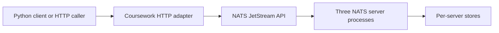
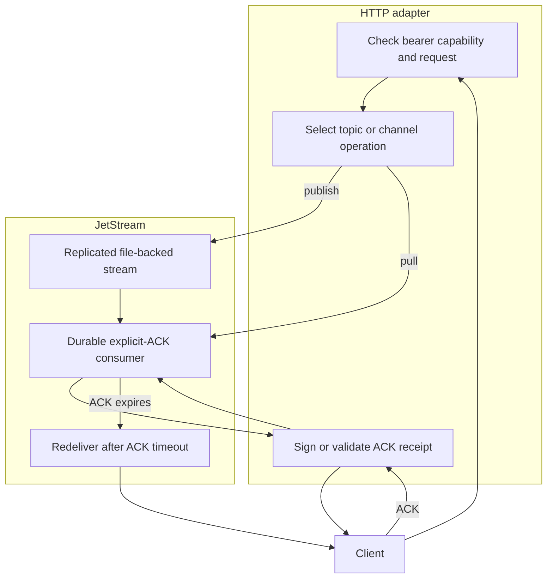

# Distributed message broker

## Contents

- [Architecture and execution guide](#architecture-and-execution-guide)
- [Build and verify](#build-and-verify)
- [Use the adapter](#use-the-adapter)
- [Delivery and resource limits](#delivery-and-resource-limits)

The [hosted broker measurement](coursework/BENCHMARK-RESULTS.md) completed 12,000/12,000 messages at 100 messages/s for 120 seconds, with scheduled-to-delivery+ACK p50/p95/p99 of 2.713 / 3.067 / 3.374 ms. At 1,024 bytes and four producers/consumers, five short 64-message batches had median throughput 423.863 messages/s (range 419.094–427.768). The 500/s sweep finished 2,874 of 5,000 offers and declined 2,126 at the generator; its negative verdict remains. Leader loss recovered all 64 messages, with first newly invoked post-kill ACK at 6.676 seconds and every transient error retained. Four visible Linux cores, Python 3.11.17 and Go 1.26.0; CPU model/RAM and native/adapter bottleneck profiles remain gaps. These are adapter/workload results, not maximum NATS capacity.

The [replicated benchmark driver](.agents/skills/verify-broker/features/benchmark.md) is reproducible with `python coursework/benchmark.py benchmark` on isolated Linux; `smoke` checks correctness and `profile` supplies separate diagnostics. Exact source, commands, five-repeat ranges, negative cells, resources and raw hashes are documented with the results. The 32 MiB retained-stream limit is unchanged.

A complete NATS JetStream broker with a course-facing HTTP topic/channel API, a Python standard-library client and a repeatable three-process failure/recovery oracle. Topics use three disk-backed replicas. Each durable channel receives the topic independently; workers sharing a channel divide its messages and explicitly acknowledge receipts.

This is a licensed adaptation of [NATS server v2.15.1](https://github.com/nats-io/nats-server/releases/tag/v2.15.1), pinned at `b2fd3efc7456b11b06a54877ad6f6ccfb911edb4`. The entire upstream history, implementation, tests, license and notices are retained. [README.upstream.md](README.upstream.md) is the unchanged upstream README. The upstream project owns the broker, Raft replication, storage, recovery and client protocol. The additions here are `coursework/`, its verification skill and documentation, covered by the repository's Apache-2.0 license.

The coursework connection is Stanford CS244b's [KiraraMQ report](https://www.scs.stanford.edu/24sp-cs244b/projects/KiraraMQ_A_Lightweight_Fault_Tolerant_and_Distributed_Message_Queue.pdf), by Zhemin Huang, Gavin Li, Ericka Liu and Yichun Qian. This adaptation studies its topics, channel fanout, shared consumers and retry semantics using an available licensed production broker. It does not reproduce the unavailable student source, KiraraMQ's etcd discovery or gRPC API. Durable replicated logs and explicit quorum-loss experiments are the extension, drawing on the durable-log design discussed in [Kafka's 2011 paper](https://notes.stephenholiday.com/Kafka.pdf). No university completion, original consensus algorithm or comparative performance claim is made.

## Build and verify

Requires Go matching `go.mod` (validated locally with Go 1.27.3), Python 3.11+, no containers, credentials or paid services. The existing `nats.go v1.53.1` dependency is reused without changing module dependencies.

```powershell
go build -o .local/nats-server.exe .
go build -o .local/topic-channel.exe ./coursework/cmd/topic-channel
go test ./coursework/...
go vet ./coursework/...
go test ./server -run '^TestJetStreamConfig(ExplicitZeroLimits|NegativeLimitsFallBackToDynamic)$' -count=1
python coursework/verify.py
```

The `.exe` output names also work as executable filenames on Linux. The driver starts three separate loopback processes with owned stores, random ports and random authentication. It exercises HTTP/Python, exits an unacknowledged consumer process, checks redelivery attempts and duplicate publisher IDs, shares a channel between workers, kills the actual stream leader, proves a quorum write, removes another replica and requires bounded write rejection. It restarts the same stores and finally the full cluster. Its accepted-message oracle checks payloads, sequences and durable channel ACK state. A timed-out write is recorded as uncertain rather than counted as acknowledged or lost.

Every run retains logs, PIDs, actions, ledger, monitoring snapshots and `result.json` beneath `.local/evidence/`. Cleanup terminates only owned processes and preserves evidence after failures. These local folders include generated cluster capabilities and must remain ignored. CI uploads only logs and proof JSON, never configurations or credentials. The [verification skill](.agents/skills/verify-broker/SKILL.md) and [feature map](.agents/skills/verify-broker/features/README.md) are maintained entry points. Upstream release/external-service workflows remain reference material in `.github/upstream-workflows/`; the bounded active workflow runs the adaptation's checks.

## Use the adapter

Run three NATS servers using distinct stores, `server_name`s and loopback client/route ports in one JetStream cluster. See generated `.local/evidence/<run>/node*.conf` for complete local configurations. Each has a 64 MiB memory and 128 MiB disk budget. Start each configuration with `.local/nats-server.exe -c PATH`. Set `NATS_TOKEN` to their shared random capability. Generate a separate `BROKER_TOKEN` of at least 32 random characters, retained across adapter restarts.

```powershell
.local/topic-channel.exe -listen 127.0.0.1:8080 -servers nats://127.0.0.1:4222,nats://127.0.0.1:4223,nats://127.0.0.1:4224
```

```python
import os, sys
sys.path.insert(0, 'coursework')
from client import Broker
b = Broker('http://127.0.0.1:8080', os.environ['BROKER_TOKEN'])
b.topic('orders')
b.channel('orders', 'billing')
b.publish('orders', 'invoice 42', 'invoice-42')
for message in b.pull('orders', 'billing'):
    print(message['sequence'], message['attempt'], message['data'])
    b.ack('orders', 'billing', message['receipt'])
```

All HTTP calls require `Authorization: Bearer <BROKER_TOKEN>`. Operations are `PUT /topics/{topic}`, `PUT /topics/{topic}/channels/{channel}`, `POST /topics/{topic}/messages` with `data` and `publisher_id`, and `POST /topics/{topic}/channels/{channel}/pull` or `/ack` with `receipt`. Names allow 1..48 ASCII letters, digits, underscores or hyphens. Publisher IDs allow the same alphabet up to 96 characters. Creation is idempotent for the fixed configuration. Publish returns sequence and duplicate flag; pull returns zero or one message, stream sequence, delivery attempt and signed receipt.

## Delivery and resource limits

[JetStream pull consumers](https://docs.nats.io/learn/jetstream/pull-consumers) provide shared work and explicit ACK. [Clustered JetStream](https://docs.nats.io/learn/topologies/jetstream-in-a-cluster) owns replicated stream and durable-consumer state. A new channel begins at the first retained message. ACKs do not delete retained messages. Each stream is capped at 100,000 messages or 32 MiB and 64 channels, rejects new messages when full and caps payloads at 32 KiB. Retention management and deletion remain native NATS administration operations.

The API has 32 in-flight operations, a 64 KiB JSON body cap, finite HTTP deadlines and a 2-second broker request deadline. Pull waits at most 750 ms. Consumers allow 128 pending acknowledgments. Unacknowledged messages become eligible for retry after 2 seconds. Publisher deduplication lasts 2 minutes; reuse an ID only for the same logical payload. Beyond that window duplicates are possible. Native per-stream sequences are ordered; parallel processing and retries need not finish in sequence order.

Receipts are HMAC-signed, bound to topic/channel and the configured server-address list, constrained to the generated JetStream ACK namespace and expire after 10 minutes. Use a separate random `BROKER_TOKEN` per deployment. Keep the same server-address list across adapter restarts to preserve receipts. Receipts authorize no arbitrary NATS subjects. A stale delivery's valid ACK follows native JetStream semantics and can acknowledge a message after redelivery; signing does not create exactly-once processing. Keep application side effects idempotent. Changing the capability or address list invalidates existing receipts, allowing ordinary timeout redelivery.

This is a single-tenant local teaching surface. HTTP and NATS addresses must be numeric loopback addresses; there is no remote TLS or tenant authorization layer. Anyone with the capability can use all topics. Native NATS administration bypasses adapter limits and must remain trusted. Process-crash recovery on local stores is tested. Disk failure, power-loss durability, network partitions, cross-host availability and production load remain unverified.

## Architecture and execution guide

This repository contains the complete upstream NATS server and its JetStream implementation. The added scope is a Go HTTP adapter, a Python client, and local verification. NATS owns persistence, replication, leader election, stream sequences, and consumer state. The adapter translates a small topic/channel API into JetStream operations.

This boundary map shows how requests reach the inherited broker and its replicated storage.



The adapter authenticates and validates HTTP requests, then calls JetStream. JetStream replicates stream and durable consumer state across the configured NATS cluster. The Python client adds request construction and optional observation; it does not change delivery guarantees.

The request flow below shows the publish and consume paths, including retry eligibility after a missed ACK.



An ACK receipt binds the topic, channel, broker address list, expiry, and JetStream ACK subject. The adapter verifies its HMAC before issuing the ACK request. A lost response can leave the publish outcome uncertain; the caller must use the same publisher ID only for the same logical payload.

| Subsystem | Responsibility | Owned state or invariant | Source |
| --- | --- | --- | --- |
| HTTP adapter | Authentication, request limits, routing, receipt checks | 32 in-flight slots; 64 KiB JSON cap; loopback-only binding | [`coursework/cmd/topic-channel/main.go`](coursework/cmd/topic-channel/main.go) |
| Python client | Build API calls and expose broker results | Uses one bearer capability; leaves retry policy to caller | [`coursework/client.py`](coursework/client.py) |
| JetStream stream | Retain and replicate topic messages | Three replicas, bounded message and byte counts, two-minute duplicate window | [`server/jetstream.go`](server/jetstream.go) |
| Durable consumer | Fan out channels and divide channel work | Explicit ACK, 2-second ACK wait, 128 pending ACKs | [`server/jetstream.go`](server/jetstream.go) |
| Verification driver | Start owned nodes and check message/recovery outcomes | Tracks acknowledged versus uncertain publishes and owned PIDs | [`coursework/verify.py`](coursework/verify.py) |

Terms used in the request path: [JetStream](#concept-jetstream), [streams](#concept-stream), [durable consumers](#concept-durable-consumer), [explicit ACKs](#concept-explicit-ack), [redelivery](#concept-redelivery), [publisher deduplication](#concept-publisher-deduplication), [ACK receipts](#concept-ack-receipt), and [quorum](#concept-quorum).

### Follow one message

1. Start three NATS processes with distinct stores and shared cluster settings, then start the adapter with the same server list and `BROKER_TOKEN`.
2. The client creates a topic. The adapter creates a three-replica JetStream stream with bounded retention.
3. The client creates a channel. JetStream creates an independent durable consumer that starts at the first retained message.
4. The client publishes data and a publisher ID. JetStream returns a stream sequence or reports a duplicate inside its bounded deduplication window.
5. A client pulls one message. The adapter returns its sequence, delivery attempt, and signed ACK receipt.
6. The client ACKs the receipt. If it does not, JetStream can redeliver after the ACK timeout. If the broker is unavailable, HTTP returns an error; retrying a timed-out publish may still encounter an already-committed message.

### Design decisions and limits

These rationales are inferred from the current implementation. They do not record historic design intent.

| Choice | Practical rationale | Alternative and cost | Reconsider when |
| --- | --- | --- | --- |
| Adapt JetStream instead of adding consensus or storage | Inherited NATS already owns replication and durable consumers | A custom broker could tailor semantics but would duplicate consensus, persistence, and recovery work | The required semantics cannot be expressed by JetStream |
| Use pull consumers with explicit ACK | Workers can share a durable channel and control when work is complete | Push delivery reduces polling but gives the adapter less control over demand | A real deployment needs push delivery or higher pull efficiency |
| Sign short-lived receipts containing ACK subjects | HTTP callers can ACK without receiving arbitrary NATS credentials | Server-side receipt storage avoids exposing tokens but adds state and cleanup | Multi-tenant isolation or revocation requirements change |
| Keep one bounded stream per topic | Limits retention and gives each topic native sequence numbering | Shared streams reduce stream count but complicate per-topic limits and isolation | Topic counts or retention policy exceed the fixed bounds |

### Glossary

<a id="concept-jetstream"></a>

<details><summary>What is JetStream?</summary>

JetStream is NATS's persistence and streaming subsystem. Here it stores replicated topic messages and durable consumer progress. For example, a stream is named `B_orders` for the `orders` topic.
</details>

<a id="concept-stream"></a>

<details><summary>What is a stream?</summary>

A stream is an ordered, retained sequence of messages for configured subjects. The adapter creates one per topic, with a 100,000-message and 32 MiB cap.
</details>

<a id="concept-durable-consumer"></a>

<details><summary>What is a durable consumer?</summary>

A durable consumer keeps delivery and ACK state across reconnects. Each channel maps to one consumer, so separate channels each receive the topic independently.
</details>

<a id="concept-explicit-ack"></a>

<details><summary>What is an explicit ACK?</summary>

An explicit ACK tells the broker that a delivered message is complete. The channel consumer uses it so an unacknowledged message can be retried after two seconds.
</details>

<a id="concept-redelivery"></a>

<details><summary>What is redelivery?</summary>

Redelivery is another delivery attempt after the broker has not received an ACK in time. The API reports the attempt count; processing can therefore happen more than once.
</details>

<a id="concept-publisher-deduplication"></a>

<details><summary>What is publisher deduplication?</summary>

The stream temporarily recognizes repeated publisher IDs. This adapter configures a two-minute window, so the ID does not prevent later duplicates outside that period.
</details>

<a id="concept-ack-receipt"></a>

<details><summary>What is an ACK receipt?</summary>

An ACK receipt is an HMAC-signed token that authorizes one JetStream ACK subject for a topic and channel. It expires after ten minutes and is bound to the configured server-address list.
</details>

<a id="concept-quorum"></a>

<details><summary>What is a quorum?</summary>

A quorum is the majority of configured replicas needed for replicated progress. The three-server recovery journey checks writes after leader loss, then checks bounded rejection after another replica is removed.
</details>
